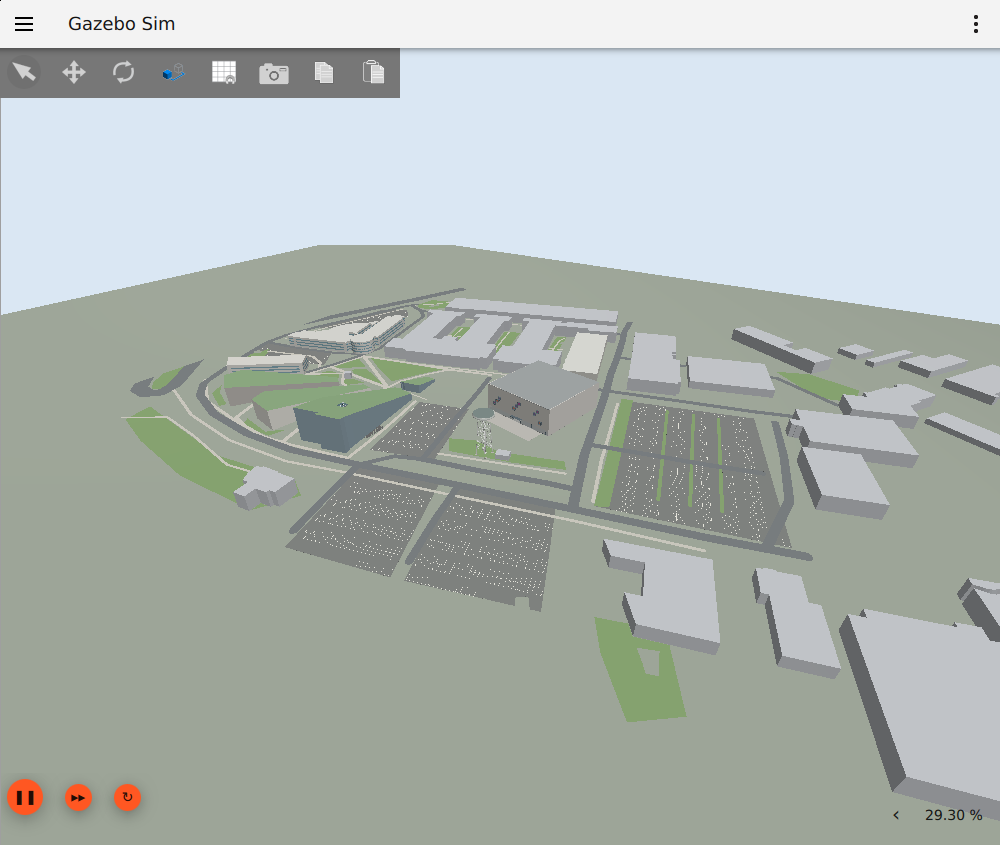
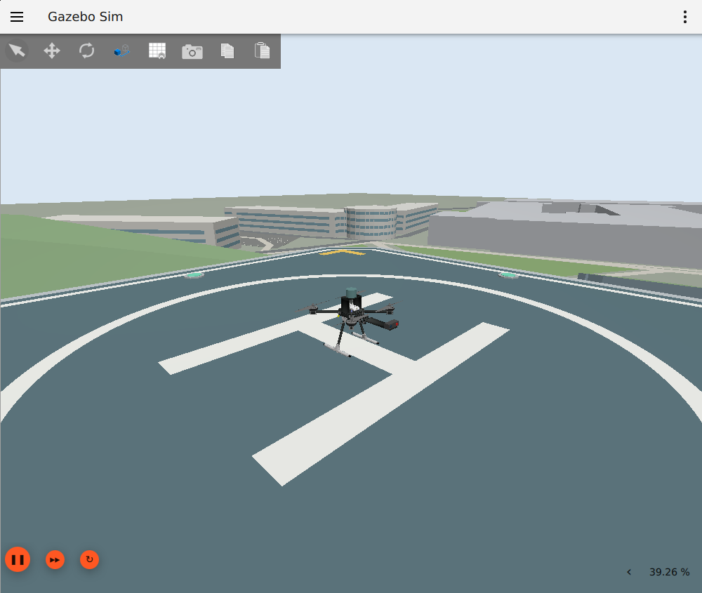
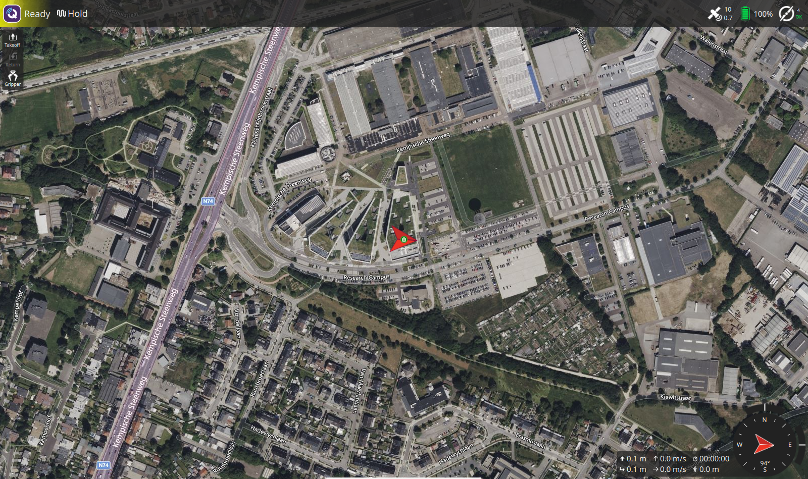
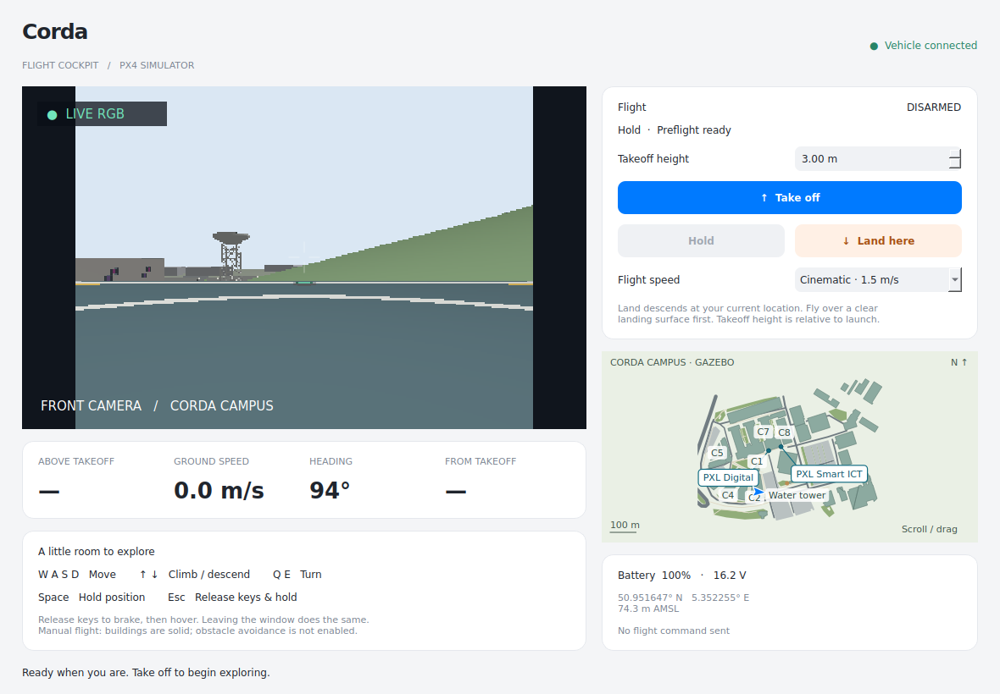
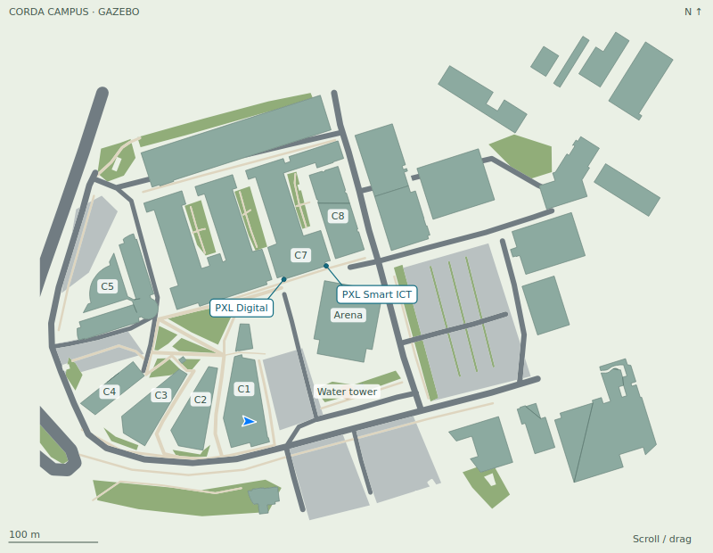

# PX4 + ROS 2 Docker development environment

PX4 SITL, Gazebo Harmonic, ROS 2 Jazzy and QGroundControl in a shared development image, with either an Xfce browser/VNC desktop or native Linux graphics. Source and builds stay in this repository's `Projects` folder; compilation and simulation run inside Docker.

Use the browser desktop for Gazebo, QGroundControl and RViz, or add the optional Corda cockpit for keyboard flight with live camera video and a campus map. The student cockpit archive, shared separately by the instructor, includes source, checks and installation instructions; it runs inside this environment. See [bundle details](docs/cockpit-release.md).

The Bash, tmux, Vim, Nerd Font and numbered-script workflow comes from `ROSLyricalDocker`. This repository has its own images, containers and PX4 examples. See [TODO.md](TODO.md) for implementation tasks and [implementation status](docs/implementation-status.md) for verified capabilities and remaining checks.

## Start here

1. Check the [host requirements](#versions-and-host-requirements), then [build and start the browser desktop](#browservnc-workflow).
2. Run `~/bin/start-px4-corda-simulation.sh` inside the container. Allow the first source download and build to finish.
3. Follow the [Python and ROS 2 tutorial](docs/tutorial/README.md) for guided exercises, or install the [student cockpit](#corda-flight-cockpit) for manual simulator flight.
4. Keep work in `Projects` and recordings in `Data`; both persist when the container is recreated.

## Current screenshots



The live Corda Campus world in Gazebo, with the rooftop launch deck, Arena, water tower, campus buildings, roads and parking.



The simulated x500 on Corda 1’s six-metre rooftop deck, fitted with the forward RGB-D camera and top-mounted 3D lidar.



QGroundControl connected to PX4, showing Ready / Hold and the vehicle at its rooftop launch location. Its satellite basemap is a geographic reference; collisions come from the Gazebo world.


RViz2 shows the RGB/depth camera panels, sensor frames and RGB-D/lidar point clouds through the prepared ROS 2 bridge. Open this view with `view_px4_sensors` inside the container. This is the existing tutorial capture; see the [screenshot notes](docs/tutorial/images/README.md) for context.



The Corda cockpit, captured on 26 October 2026: live front camera, PX4 preflight status, speed selection, flight controls and a geographic position marker. The vehicle is disarmed on the rooftop deck; takeoff-relative height and distance stay blank until control begins.



The cockpit map uses the installed Gazebo geometry, including campus buildings, roads, paths, parking and the water tower. Corda 7 is marked **C7**, with **PXL Digital** at its lower-left corner and **PXL Smart ICT** at its lower-right corner. Scroll to zoom, drag to pan and double-click to reset. These are real application captures; [capture notes](docs/images/README.md) record their context.

The [tutorial](docs/tutorial/README.md) contains eleven lessons, runnable Python examples, exercises and an instructor answer guide covering setup, telemetry, coordinate frames, offboard flight, recovery, sensors and evaluation. Start in the empty world before the Corda Campus project. Its [screenshot gallery](docs/tutorial/images/README.md) also shows Gazebo, QGroundControl, RViz, sensor previews and measured flight plots.

## Versions and host requirements

- Ubuntu 24.04, ROS 2 Jazzy, Gazebo Harmonic.
- PX4 v1.17.0 and matching `px4_msgs` release/1.17 commit.
- Micro XRCE-DDS Agent v2.4.3; QGroundControl v5.1.5.
- Exact source revisions, binary checksums and ROS repository installer version: [versions.env](versions.env).
- Docker Engine on Linux amd64 is the primary target. A graphical Linux desktop is needed only for native graphics; the VNC variant provides its own desktop.
- Budget at least 40 GB of disk for images, recursive sources and builds, and 8 GB RAM; 16 GB or more is preferable. Initial builds/downloads take time. These are planning allowances, not measured minimums.
- Install Docker and grant your ordinary user daemon access before running scripts. Build without sudo so build-time UID/GID match your user.
- NVIDIA Container Toolkit is optional and must be configured on the host separately. Intel/AMD `/dev/dri` access is detected. Software rendering is available.

ARM64 has a QGC asset selection path but is not considered supported until tested. Docker Desktop and cross-architecture emulation also require separate validation. The image contains a SITL toolchain; firmware flashing, USB devices and full embedded board toolchains are future work.

## Browser/VNC workflow

On the host, from this directory:

```bash
./001_build_px4_ros2_image.sh
./002_run_px4_ros2_container.sh
```

Open [the desktop](http://localhost:6901/vnc.html?autoconnect=true&resize=remote) with password `password`. A native VNC client can use `localhost:5901`. Both ports bind only to host loopback. Open an Xfce terminal inside the desktop, or attach from another host terminal:

```bash
./003_attach_bash_to_px4_ros2_container.sh
```

Inside the container, start the simulation with:

```bash
~/bin/start-px4-corda-simulation.sh
```

The launcher initializes persistent source checkouts, builds PX4 and ROS 2, loads the ROS overlay and starts the development session. The first run downloads sources and compiles them; subsequent builds are incremental. An existing session is attached immediately. Use `BUILD_JOBS=2 ~/bin/start-px4-corda-simulation.sh` to reduce build parallelism, or pass `--no-gazebo-gui`, `--headless` or `--no-attach` as needed.

To run the setup and build steps individually:

```bash
setup_px4_workspace
build_px4_sitl
build_ros2_workspace
# Make the newly built ROS overlay available in this shell:
source ~/Projects/ros2_workspace/install/setup.bash
start_px4_dev
```

`start_px4_dev` creates a `px4-dev` tmux session: XRCE agent, PX4 console, sensor bridge, Gazebo GUI, QGroundControl, RViz sensor viewer and a ROS shell. RViz opens with RGB/depth images and point clouds configured for the sensor bridge's Best Effort delivery. Running the launcher again restores a closed sensor viewer. `--headless` skips graphical applications; `PX4_SENSOR_SUITE=none` skips the sensor bridge and viewer. It waits for valid PX4 ROS telemetry and rendered sensor data with TF before reporting readiness. In QGC, wait for vehicle connection and preflight readiness; use the normal Takeoff/Land actions for a manual simulated flight.

From the ROS tmux window (or a newly attached shell), try:

```bash
ros2 run px4_dev_examples telemetry
# Ctrl+C exits telemetry. This next command deliberately commands a simulated flight:
ros2 run px4_dev_examples offboard_demo --sitl
```

The offboard demo requests arm, takes off 3 m relative to the initial local position, holds 5 seconds, lands, waits for automatic disarm and restores Hold mode. A GCS connection (normally QGC) and healthy estimator are required. It reports observed flight states and fails on stage timeouts. Run it only with the local simulator selected. Interrupting it requests landing and waits for confirmation; QGC and the PX4 console remain available for intervention.

Detach from tmux with `Ctrl+b`, then `d`. Detaching leaves simulation running. Stop it explicitly:

```bash
stop_px4_dev
```

From the host, the lifecycle commands are:

```bash
./997_stop_px4_ros2_container.sh
./998_remove_px4_ros2_container.sh   # for a retained container created without --rm
./999_remove_px4_ros2_image.sh
```

The default run is foreground and `--rm`: stopping it removes the container, preserving bind-mounted sources/data. The `001c`, `002c`, `003c`, `997c`, `998c`, `999c` scripts explicitly select the same VNC image.

## Corda flight cockpit

The optional native PyQt5/ROS 2 cockpit provides live RGB video, vehicle status, keyboard flight, speed selection and an interactive campus map. The launcher is in this repository; the application is installed into the persistent `px4-uav-cockpit` Docker volume. A fresh volume is empty. Put `UAVCockpit.tar.gz` in the host repository's `Data` directory and run `~/bin/start-px4-cockpit.sh --check` inside the container to extract it automatically into `~/.local/share/uav-cockpit` (or `UAV_COCKPIT_DIR`, if set) when `cockpit.py` is missing. The archive must contain `cockpit.py` at its root. An existing installation is left untouched.

Obtain the 26 October 2026 student bundle (`uav-cockpit-2026-10-26.tar.gz`) and its SHA-256 checksum from your instructor. Release archives are shared separately and kept out of Git; the instructor’s local copy is in the ignored `Data/releases` directory. It contains the latest saved cockpit source, including the map-drag fix, a launcher copy, control/map checks, attribution and `INSTALL.md`. It uses this repository's image and built ROS workspace; Docker images, PX4 sources and build outputs are separate. See [release details](docs/cockpit-release.md).

With the browser container running, put the archive in the host repository's `Data` directory. Inside a container terminal:

```bash
mkdir -p /tmp/uav-cockpit-release
tar -xzf ~/Data/uav-cockpit-2026-10-26.tar.gz -C /tmp/uav-cockpit-release
# Close an existing cockpit and back up its installation before replacing it.
mkdir -p ~/.local/share/uav-cockpit
cp -a /tmp/uav-cockpit-release/uav-cockpit-2026-10-26/. ~/.local/share/uav-cockpit/
~/bin/start-px4-corda-simulation.sh
~/bin/start-px4-cockpit.sh --check
~/bin/start-px4-cockpit.sh
```

Run `start-px4-cockpit.sh` from a terminal in the graphical container desktop. Keep QGroundControl connected and wait for preflight readiness. Stop any other offboard controller before taking control. The launcher permits one cockpit instance per ROS domain.

| Input | Action |
| --- | --- |
| Take off / Take control | Climb to the selected takeoff height / adopt the current airborne position |
| W / S, A / D | Move forward/back, strafe left/right relative to heading |
| Q / E | Turn left/right |
| Up / Down | Climb/descend |
| Space / Escape / Hold | Brake, then hold position |
| Land here | Request PX4 landing at the current location |
| Flight speed | Select 0.5, 1.5 or 3 m/s horizontal speed |

Releasing movement keys or leaving the window brakes to a hover. Takeoff height is relative to launch; airborne control acquisition uses the control-start position. Landing requires a suitable clear surface. Buildings have collisions and obstacle avoidance is not enabled. Stale telemetry disables movement; keep QGC available to intervene. The bundled cockpit shows takeoff-relative height and AMSL; the separate above-surface sensor is available over ROS but is not displayed in this saved application version.

## Native Linux display (without VNC)

The inherited `novnc` suffix means **no VNC server**. The VNC browser application itself is named **noVNC**.

```bash
./001b_build_px4_ros2_novnc_image.sh
./002b_run_px4_ros2_novnc_container.sh
```

Run from a graphical Linux terminal with a local X11/Xwayland `DISPLAY`. The launcher checks the socket and forwards a temporary Xauthority cookie; install `xauth` on the host if necessary. SSH/TCP display forwarding is unsupported. On WSLg, an absent Xauthority file can be normal, but WSLg has not been validated here.

Inside the container use the same setup/build/session commands. Gazebo and QGC open on your host display. The `003b`, `997b`, `998b`, `999b` scripts attach, stop and remove this mode's resources.

## Persistent layout

| Host path | Container path | Contents |
| --- | --- | --- |
| `Commands/bin` | `~/bin` | Developer helpers on PATH |
| `ExampleCode` | `~/ExampleCode` | PX4 walkthroughs |
| `Projects/PX4-Autopilot` | `~/Projects/PX4-Autopilot` | Pinned upstream Git checkout, edits, SITL build and parameter state |
| `Projects/ros2_workspace` | `~/Projects/ros2_workspace` | Authored examples, upstream messages and colcon outputs |
| `Data` | `~/Data` | QGC settings/cache, ULogs, bags, session logs and compiler cache |

`setup_px4_workspace` recursively fetches PX4 and its submodules and checks out `px4_msgs` at the locked revision. It preserves an existing matching checkout and edits. A different revision produces an error with guidance; setup never resets your work. If an initial network failure leaves an incomplete checkout, inspect/recover it explicitly before rerunning setup.

PX4 and px4_msgs are ignored nested upstream repositories. Commit environment scripts and authored examples in this repository; manage PX4 changes in its own Git checkout/fork. Build outputs live under `Projects`, so they survive container recreation too. Avoid sharing the same build directory between incompatible images or architectures.

Images include seed helper/example files outside mount locations for use without bind mounts. A fresh image-only workspace is initialized by the same setup command. Mounting a host folder intentionally makes the host files authoritative.

## Development and configuration

Edit PX4 source on the host or in container Vim. Stop SITL, run `build_px4_sitl` and restart it. Run `build_ros2_workspace` after ROS changes and source the install setup in the current shell. New interactive shells automatically source ROS and any existing workspace overlay.

`clean_and_rebuild_ros2_workspace` removes only this ROS workspace's generated `build`, `install` and `log` folders, rebuilds and sources the result. Sources are preserved. For PX4 clean builds, use the upstream build commands deliberately; no cleanup runs automatically on startup.

The tmux and Vim configuration files are copied from the reference. All declared plugins are installed during image build at revisions in `docker/plugins.lock`. tmux uses Nord and tmux-sensible; Vim retains Gruvbox, Airline and the original mappings/settings. Command-T uses its Vim-compatible Ruby release, with a Ruby-enabled Vim build. The Xfce terminal uses the supplied Cascadia Nerd Font.

Useful commands inside the container:

```bash
px4_doctor
BUILD_JOBS=4 build_px4_sitl
start_px4_dev --no-attach
start_px4_sitl --headless       # standalone; start the XRCE agent separately
start_micro_xrce_agent
start_qgroundcontrol
px4_command commander status
record_px4_rosbag
rviz2
glxinfo -B
```

`start_px4_sitl` uses an x500 with the RGB-D/lidar suite and the bundled `corda_campus` world. `PX4_GZ_WORLD` selects another bundled world. Parameters persist under `Projects/PX4-Autopilot/build/px4_sitl_default/rootfs/parameters.bson`; stop SITL and back up that file before any deliberate reset. Flight ULogs are linked into `Data/px4/logs`; ROS recordings go into `Data/bags`; tmux service output goes into timestamped `Data/sessions` directories. Use the installed `pyulog` tools for ULog inspection and `ros2 bag info/play` for ROS bags.

The world's geographic origin remains **50.951737° N, 5.352412° E**, with assumed flat ground at **50 m AMSL**. In the campus world, the actual drone starts on the Corda 1 roof at local East/North **(-11, -10) m**, approximately **50.9516471° N, 5.3522555° E**. The platform is about **23.974 m above ground**; the vehicle rests about **74.214 m AMSL**. These are approximate simulation coordinates, not a surveyed launch position. QGC discovers this actual vehicle/home location from PX4.

To relocate the entire world geographically, stop the session and supply all three origin values inside the container (the campus geometry and rooftop spawn retain their local offsets):

```bash
stop_px4_dev
PX4_HOME_LAT=50.951737 PX4_HOME_LON=5.352412 PX4_HOME_ALT=50 start_px4_dev
```

The same overrides work with standalone `start_px4_sitl`. Location changes require restarting SITL.

QGC configuration and cache use `Data/qgc`. To reset its settings, stop QGC and move that folder aside. QGC-selected mission export locations should be placed under `~/Data` or `~/Projects` to keep them across container removal.

Host-side overrides and extra arguments:

```bash
VNC_PW=secret VNC_RESOLUTION=1920x1080 WEB_PORT=6902 VNC_PORT=5902 \
  GPU_MODE=software ./002_run_px4_ros2_container.sh
BUILD_JOBS=2 build_px4_sitl  # inside container, for constrained hosts
./001b_build_px4_ros2_novnc_image.sh --build-arg USER_UID=1001 --build-arg USER_GID=1001
./002h_run_px4_ros2_headless_container.sh -- bash -lc 'px4_doctor'
```

Build scripts forward Docker build options. Run scripts accept Docker options before an optional `--`; words after `--` replace the container command. `GPU_MODE` accepts `auto`, `nvidia`, `dri`, or `software`. VNC acceleration depends on its X server; inspect the actual renderer rather than assuming GPU passthrough accelerates Xvnc. Classic VNC password authentication uses only the first eight characters. Use SSH tunnels for remote desktop access.

## Corda Campus world

The default `corda_campus` world contains **29 buildings selected from 82 actual GRB footprints**, with angled/concave outlines, rounded facades and courtyards preserved as triangulated meshes. Visual and collision geometry match. Corda 1, its companion, Corda 2 and Corda 3 have sloping wedge roofs; Corda Arena and nearby offices retain their mapped outlines. Other roofs are mostly flat. Corda 1/2/3 have separate green roof and blue-grey/light/warm-grey facade materials. Their roof slopes are approximated from campus references; full closed collision meshes match the combined visual surfaces.

For performance, 53 small peripheral buildings are omitted and static visuals are batched by material, reducing the scene to 75 batched visuals. The source snapshot remains intact, and omitted IDs are recorded in `simulation/campus.json`. Camera/lidar resolution and rate remain unchanged.

Heights use available 3D GRB values matched by stable building IDs, architectural dimensions where available and explicit estimates for missing data. Corda 1's 30 m maximum comes from the architect; the detailed roof plane remains approximate. All sources, licences, data dates and approximation rules are documented in [tools/campus/SOURCES.md](tools/campus/SOURCES.md). The Arena now has a hollow roofed hall, glazed entrance, open simulation doors, simple internal galleries and projecting cube facade detail. The 35 m Philips water tower has open lattice supports, stairs and a saucer tank. Six traced parking areas have illustrative bay markings; Corda 4 has window bands; Corda 5 has separate office wings, a lower curved hall and a round entrance drum. Corda 8 has nine sawtooth roof sections and clerestory strips. These are untextured approximations: detailed interiors, terrain, trees, cars and surveyed rooftop structures are omitted.

A **synthetic level 6×6 m chamfered landing deck** sits above Corda 1's sloping roof so the drone can stand and land stably. It has a roof-conforming plinth, metal edge trim, a white H/circle, perimeter markings and inset marker lenses. Its landing area is clear and level; it is not a real helipad. The generator verifies the platform lies inside the roof footprint. The spawn is at approximately 50.9516471 N, 5.3522555 E. Footprints and the tower use native EPSG:3812 coordinates transformed locally, correcting an offset in the WFS geographic-coordinate response.

The campus includes reference-traced roads, walkways and green areas across the modeled site. The three parking layouts near C1 use the corrected straight campus-grid alignment. The cockpit overview is generated from the final Gazebo geometry (`simulation/campus-map.json`), including concave buildings, the Arena, parking, paths and the water tower. Scroll to zoom, drag to pan and double-click to reset. Rebuilding the ROS package updates the map alongside the world; see `tools/campus/SOURCES.md` for references and approximation limits.

For an existing container/workspace, install the new assets and restart:

```bash
stop_px4_dev
build_ros2_workspace --packages-select px4_dev_examples
source ~/Projects/ros2_workspace/install/setup.bash
start_px4_dev --no-attach
# Verify the disarmed vehicle stays at the rooftop elevation:
ros2 run px4_dev_examples campus_check
```

`start_px4_dev --no-gazebo-gui --no-attach` runs QGroundControl and both sensors without the separate 3D viewer, reducing desktop rendering load. Use `start_gazebo_gui` later to open the viewer.

`start_gazebo_gui` opens the normal Gazebo controls with a view of the campus landmarks and parking. It supplies the installed campus resource paths for meshes. The `sensors` window bridges the selected world's clock, so the existing RViz viewer also works in the campus.

To use the original empty world, stop the session and run `PX4_GZ_WORLD=default start_px4_dev`. To use campus geometry without rendered sensors, use `PX4_SENSOR_SUITE=none start_px4_dev`. `PX4_GZ_MODEL_POSE` can explicitly override the default local spawn (`x,y,z,roll,pitch,yaw` in metres/radians); ensure any alternative starts clear of buildings. An explicit world/pose override is forwarded to tmux even if its server was already running.

All world/model/mesh assets are local, so simulation needs no map download. Editable source footprints, height attributes and overrides are under `tools/campus`; generated assets and a per-building provenance report are installed under the ROS package's `simulation` directory. Regeneration is an optional offline GIS build step described in the source notes; ordinary Docker image builds just package the checked-in meshes. Software rendering and complex collisions can reduce simulation speed.

The integration check `bash /opt/px4-tests/campus.sh` starts and stops its own headless session, verifies rooftop support for several seconds and checks sensor payloads/TF. Run it only without an active development session. The ordinary opt-in offboard demo takes off relative to the rooftop and returns to the launch platform.

## RGB-D camera and 3D lidar

The default drone includes a level, forward-facing RGB-D camera and a roof-mounted 3D lidar. The camera sits low on a carbon-fiber shoe on a carbon-fiber extension of the lower front platform. Its optical origin sits 35 cm ahead of the body center, beyond the entire front rotor sweep (about 32.1 cm), with the ROS transform matching the mount. The lidar sits on a slim, carbon-fiber inverted-U bridge with two side legs, leaving the flight controller clear underneath. Both mounts reuse the x500 frame’s carbon weave texture. The blue RGB and red depth windows indicate the camera's +X viewing direction. Both assemblies are fixed to the UAV body. The authored model extends the pinned upstream x500 without editing its source or Gazebo model repository. The sensor assemblies use 70 g camera mass and 150 g lidar mass.

| Sensor | Configuration | ROS 2 topics |
| --- | --- | --- |
| RGB-D | 320 × 240, 87° horizontal FOV, RGB view 0.15–500 m, depth 0.15–20 m, 10 Hz simulation time | `/drone/rgbd/image`, `/drone/rgbd/depth_image`, `/drone/rgbd/camera_info`, `/drone/rgbd/points` |
| 3D lidar | 720 horizontal × 16 vertical samples, 360° × 30° FOV, 0.1–50 m, 10 Hz simulation time | `/drone/lidar/points` |

RGB uses `sensor_msgs/Image` with `rgb8`; depth uses `32FC1` in metres. Both clouds use `sensor_msgs/PointCloud2`. The lidar cloud contains all 16 vertical channels; it is not a single-plane LaserScan. Update rates are configured simulation rates; actual throughput depends on rendering hardware and subscribers.

After updating an existing checkout, rebuild the ROS package inside the container and restart the session:

```bash
stop_px4_dev
build_ros2_workspace --packages-select px4_dev_examples
source ~/Projects/ros2_workspace/install/setup.bash
start_px4_dev --no-attach
view_px4_sensors
# In another shell: check payloads, advancing stamps and TF; save optional previews:
ros2 run px4_dev_examples sensor_check --save ~/Data/evidence/sensors
```

The `sensors` tmux window runs `ros2 launch px4_dev_examples sensors.launch.py`. Standalone `start_px4_sitl` starts the model/server only; launch that bridge separately for ROS sensor topics. When choosing another world, give that bridge the matching `PX4_GZ_WORLD` environment value as well. The bridge uses best-effort sensor QoS and lazy subscriptions so unused streams avoid unnecessary transfers. For direct inspection, use `--qos-reliability best_effort`. Sensors also work without a display server using Gazebo's Ogre2 EGL headless rendering; software rendering can be slower.

`view_px4_sensors` opens the included RViz configuration with RGB/depth panels and both clouds. Its fixed frame is `base_link` (ROS FLU). Static TF connects that frame to `lidar_link`, `rgbd_link`, `rgbd_sensor` and `rgbd_optical_frame`. Images and camera info use the optical frame (+Z forward, +X right, +Y down). The RGB-D cloud uses `rgbd_sensor` (+X forward, +Y left, +Z up), matching Harmonic's point coordinates; the bridge corrects its misleading optical frame label. This is a vehicle-relative view; no map/odometry TF, SLAM or obstacle-avoidance controller is provided. These sensors feed ROS perception and do not automatically change PX4 flight behaviour or stream camera video into QGC.

Sensor timestamps and `/clock` use Gazebo simulation time. The sensor launch bridges the selected world's clock; RViz uses `use_sim_time:=true`. Keep the existing PX4 offboard control nodes on their documented wall-time setup. Do not launch a second clock bridge at the same time.

To run without the rendered sensor suite, stop the session and use `PX4_SENSOR_SUITE=none start_px4_dev` (the campus world remains selected). The same selector works with standalone SITL. Sensor-free runs do not require the rendered sensor checks or publish these sensor topics. To record sensors alongside control telemetry, pass their topics explicitly, for example:

```bash
record_px4_rosbag /drone/rgbd/image /drone/rgbd/depth_image \
  /drone/rgbd/camera_info /drone/lidar/points /tf_static /clock
```

A downward-facing rangefinder is mounted beneath the front platform. It measures the surface at the current location (roof, platform, or ground), independently of takeoff-relative altitude. `/drone/height/scan` carries the single Gazebo laser ray; `/drone/height/range` publishes `sensor_msgs/Range` (0.05–100 m, 20 Hz). `/drone/height/above_surface` publishes `std_msgs/Float32`: metres from the UAV body origin to the beam's surface hit, using PX4 attitude to correct tilt and sensor offset. Missing/stale data, no return, or tilt above 30° produces NaN. The student cockpit bundle currently displays **ABOVE TAKEOFF** and AMSL; a consumer can subscribe to `/drone/height/above_surface` for surface clearance. At nonzero tilt the beam hit is horizontally displaced, so this is not a terrain map or an exact measurement directly below the body at an edge. This ROS sensor does not change PX4 altitude control or enable terrain following.

Camera/lidar definitions, bridge YAML and RViz settings live under `Projects/ros2_workspace/src/px4_dev_examples/{simulation,config,launch}`. Rebuild that package after asset/config changes. The integration check `bash /opt/px4-tests/sensors.sh` starts and stops its own headless session; run it only when no development session is active.

## Networking, ROS topics and time

**MAVROS is not used.** The ROS 2 examples and cockpit use `px4_msgs` through PX4’s uXRCE-DDS client and the Micro XRCE-DDS Agent. QGroundControl uses a separate MAVLink connection.

Default Docker bridge networking works because all components run inside the same container:

| Path | Transport | Default endpoint |
| --- | --- | --- |
| PX4 client → Micro XRCE-DDS Agent | UDP | Container localhost:8888 |
| PX4 → QGroundControl | MAVLink/UDP | Container localhost:14550 |
| Agent ↔ ROS nodes | DDS | Common `ROS_DOMAIN_ID`, default 0; Fast DDS RMW |
| Browser → noVNC → VNC | HTTP/WebSocket + RFB | Host loopback 6901 / 5901 |

No XRCE/MAVLink host port is published by default. Running host-side QGC or ROS nodes requires explicit PX4 destination addressing, DDS discovery and appropriate network access; publishing a UDP port alone does not route outbound PX4 telemetry to a host application. This external topology is outside the verified baseline.

Message topics with a nonzero `MESSAGE_VERSION` have a `_vN` suffix. The provided nodes and bag recorder derive names from the installed definitions; `ros2 topic list` shows the actual names. Subscriptions use compatible best-effort QoS. Direct `ros2 topic echo` may need `--qos-reliability best_effort`.

The baseline control examples use system time in microseconds and PX4's normal XRCE synchronization. They do not enable `use_sim_time`. For sensor-free sessions, an optional visualization clock bridge is available via `ros2 launch px4_dev_examples clock.launch.py`; use it only for nodes configured for that clock. A full conversion of PX4/ROS control to Gazebo time requires coordinated PX4 synchronization settings and has not been validated here.

PX4 local positions use NED: positive X north, Y east, Z down. The demo sets a negative Z change for takeoff and does not interpret ROS ENU values as PX4 coordinates. ROS ENU → NED maps `(x,y,z)` to `(y,x,-z)`; body FLU → FRD flips Y and Z. For quaternion transforms, account for both world and body frames and ordering explicitly.

## Checks and troubleshooting

```bash
./tests/static.sh
python3 tests/tutorial.py
./tests/image-smoke.sh px4_ros2_novnc:latest
./tests/desktop.sh
# Inside a built development container, with no other session/QGC running:
bash /opt/px4-tests/flight.sh
bash /opt/px4-tests/sensors.sh
bash /opt/px4-tests/campus.sh
```

The flight test starts headless SITL and a local test GCS heartbeat, then asserts arm/takeoff/hold/land/disarm. It does not replace the manual QGC visual/flight test. GitHub Actions is not used. Run validation locally with the scripts above. See `docs/implementation-status.md` for actual results.

- **No ROS telemetry:** check XRCE agent logs, PX4 client startup, matching message definitions and `ROS_DOMAIN_ID`; inspect QoS and version suffixes. Use `px4_doctor`.
- **No QGC vehicle:** confirm PX4 is running and QGC's UDP autoconnect is enabled; another listener on 14550 can interfere. Host QGC requires a different routing setup.
- **Arm/mode rejected:** read command acknowledgements and PX4 preflight/failsafe messages. Wait for estimator readiness and QGC connection; do not disable safety checks globally.
- **Black/failed GUI:** inspect Qt/XCB diagnostics and `glxinfo -B`; try `GPU_MODE=software`, check Xauthority for native mode, or use VNC.
- **Stale build/version conflicts:** stop the session; review `versions.env`, source revisions and compiled workspace. A changed PX4 message schema requires a matching px4_msgs rebuild.
- **Permission errors:** check image UID/GID against host ownership. Rebuild with the right user IDs rather than running the environment as root.
- **Memory/disk pressure:** lower `BUILD_JOBS`, inspect generated builds/caches, and remove only reviewed disposable output. Lifecycle scripts never prune all Docker resources.
- **Desktop ports occupied:** use `WEB_PORT`/`VNC_PORT` overrides. This is also needed when running the reference environment alongside this one. Give concurrent PX4 simulations distinct `ROS_DOMAIN_ID` values to avoid mixing their identically named ROS topics.

Initial image/source setup requires internet. The bundled x500/default-world assets are local after recursive source setup; QGC maps and optional remote models can still require internet. Apt and transitive dependency versions are recorded in the image but are not repository-snapshot locked. Upgrade source pins, messages, agent and QGC together, rebuild both images/workspaces, and rerun integration tests before claiming the new combination supported.

## License

Environment code uses the [MIT license](LICENSE), retaining the reference project's attribution. Fonts retain their included license. PX4, px4_msgs, eProsima dependencies, QGroundControl and editor plugins retain their upstream licenses; their downloads/checkouts are separate from this repository's authored code. See [third-party notices](docs/third-party.md).
