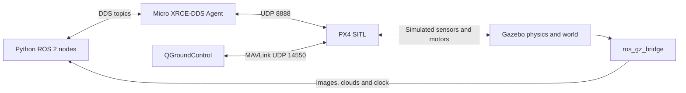

# 1 Understand the system

Your goal is to explain where a position target goes and where the measured position comes from. A ROS publisher alone does not make a drone fly: PX4 must accept the control mode and commands and have a usable estimate of its state.



**SITL** means software in the loop: PX4 runs as a process rather than on a flight-controller board. Gazebo simulates the vehicle, environment and sensors. PX4 estimates vehicle state, runs its controllers and drives simulated motors. Your offboard Python node chooses targets. It does not implement motor mixing or attitude stabilisation.

The XRCE agent connects PX4's client to DDS and ROS 2. In contrast, QGC uses MAVLink for vehicle status and operator actions. The Gazebo sensor bridge publishes camera/lidar data to ROS. These are different communication paths: QGC can be connected even when the ROS path is broken.

## Inspect the running system

After lesson 2 starts the environment, run in the **Container**:

```bash
ros2 node list
ros2 topic list
px4_command commander status
```

Look for `/fmu/out/…` telemetry and `/fmu/in/…` command/setpoint topics. Camera topics start with `/drone/`. The exact output-topic suffix can depend on the installed message version; lesson 4 resolves it in Python.

## Exercise

Draw the path for (a) measured local position, (b) your next position target, (c) an RGB image and (d) QGC's Land action. Mark which component makes the vehicle physically move. Explain why a point cloud appearing in RViz does not imply obstacle avoidance.

**Checkpoint:** you can distinguish the simulator, autopilot, ground station and ROS application. You can identify two independent ways to observe vehicle state: QGC and ROS telemetry.

[Next: build and start →](02-environment.md)
