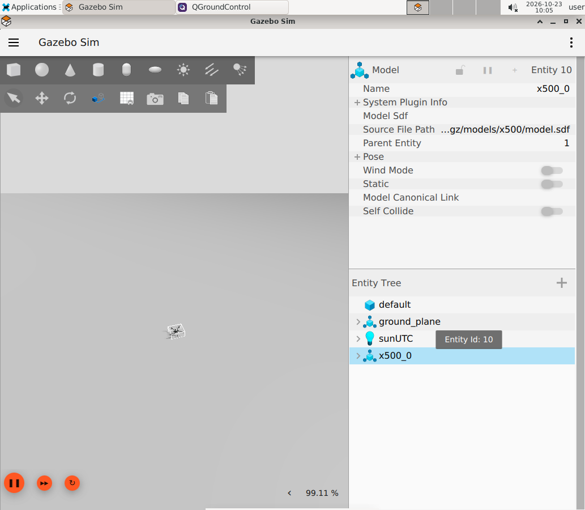

# 2 Build and start the environment

Your goal is to reproduce the teaching setup and understand which files survive container removal. Initial downloads and compilation can take much longer than a lesson; prepare them before class.

## Build on the host

Install Docker Engine and ordinary-user Docker access on a Linux amd64 host. Plan at least 40 GB disk and 8 GB RAM, preferably 16 GB. See the [root requirements](../../README.md#versions-and-host-requirements) for supported modes.

**Host**, repository root:

```bash
./001_build_px4_ros2_image.sh
./002_run_px4_ros2_container.sh
```

Open [the local desktop](http://localhost:6901/vnc.html?autoconnect=true&resize=remote), password `password`. Keep the launcher terminal open. Open another **Host** terminal:

```bash
./003_attach_bash_to_px4_ros2_container.sh
```

For software rendering on a host without a usable GPU, supply `GPU_MODE=software` before the run script. Native Linux graphics is an alternative described in the root README; this course uses VNC screenshots.

## Prepare sources and builds

**Container**:

```bash
setup_px4_workspace
build_px4_sitl
build_ros2_workspace
source ~/Projects/ros2_workspace/install/setup.bash
PX4_GZ_WORLD=default start_px4_dev --no-attach
ros2 run px4_dev_examples telemetry --once
```

Wait for startup to finish. The last command should print valid NED position and vehicle state. `default` selects the simple world for early exercises. An unqualified start uses Corda Campus.



This earlier baseline capture uses a sensor-free x500; the current default model adds camera/lidar housings. The empty-world controls and workflow are the same.

## Use tmux and persistent folders

```bash
tmux attach -t px4-dev
```

Select windows using `Ctrl+b`, then `w`; use arrow keys and Enter. Windows include `agent`, `sitl`, `sensors`, `gazebo`, `qgc` and `ros`. Detach with `Ctrl+b`, then `d`. Detaching leaves everything running. To stop services, use `stop_px4_dev` from a container shell. Stop the container from the host with `./997_stop_px4_ros2_container.sh`.

| Container folder | Host folder | Purpose |
| --- | --- | --- |
| `~/Projects/PX4-Autopilot` | `Projects/PX4-Autopilot` | PX4 sources and compiled SITL |
| `~/Projects/ros2_workspace` | `Projects/ros2_workspace` | ROS sources and build outputs |
| `~/ExampleCode` | `ExampleCode` | Python teaching scripts |
| `~/Data` | `Data` | Bags, logs and results |

Do not install ROS or compile PX4 separately on the host for this course. The bind mounts make host edits visible inside Docker.

## Exercise and checkpoint

Create `~/Data/tutorial/notes.txt`, stop and recreate the container, and confirm that it remains. Restart the simple world. Run `px4_doctor` if telemetry does not appear. Check the `sitl` and `agent` tmux logs before changing configuration.

**Checkpoint:** you have a connected QGC vehicle, a Gazebo drone and a successful `telemetry --once` result. You can attach, detach and stop deliberately.

[Next: fly with QGC →](03-qgroundcontrol.md)
