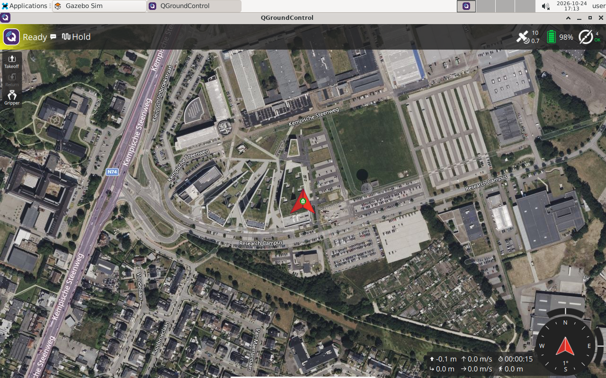

# 3 Observe a flight in QGroundControl

Your goal is to connect operator actions to actual flight states before writing control software. Start the simple world from lesson 2, with the vehicle disarmed. Do not run a ROS flight program during this exercise.



The screenshot shows a connected simulated vehicle. The background map is geographic imagery; it is not the Gazebo collision world. Early lessons use an empty Gazebo world even when QGC shows real buildings on its map.

## Take off and land

1. Select the QGC Fly view and wait for a vehicle, position and preflight readiness. A Disconnected label means you must fix connectivity first.
2. Use the Takeoff action and its confirmation control. Read the requested height before confirming; choose a small height for this exercise.
3. Observe the vehicle rising in Gazebo. Read the flight mode and armed state in QGC. Takeoff changes the flight state; a clicked button alone is not proof of completion.
4. Let the drone hold. Select Land and confirm it. Watch descent, touchdown and automatic disarming.
5. Note the difference between landed and disarmed. Do not stop the container as a substitute for landing.

QGC labels and action placement can change with window size and vehicle state. Keep the normal preflight checks enabled. A refusal to arm is a diagnostic signal, not a reason to disable checks.

**Container**, after the flight:

```bash
px4_command commander status
ros2 run px4_dev_examples telemetry --once
ls -lt ~/Data/px4/logs
```

## Exercise

Write a table with four observations: before takeoff, climbing, holding and after landing. Include mode, armed state, height trend and visible Gazebo motion. Explain whether QGC's relative altitude, AMSL altitude and ROS local `z` should display the same number.

If QGC stays disconnected, verify `start_px4_dev` completed, check the `sitl` and `qgc` windows, and confirm UDP autoconnect is enabled in QGC's communication settings. Use the QGC inside this container; an additional host QGC can compete for a UDP listener.

**Checkpoint:** you have observed one complete takeoff and landing, ending disarmed. You can identify QGC's Land action before running ROS control.

[Next: read telemetry →](04-telemetry.md)
