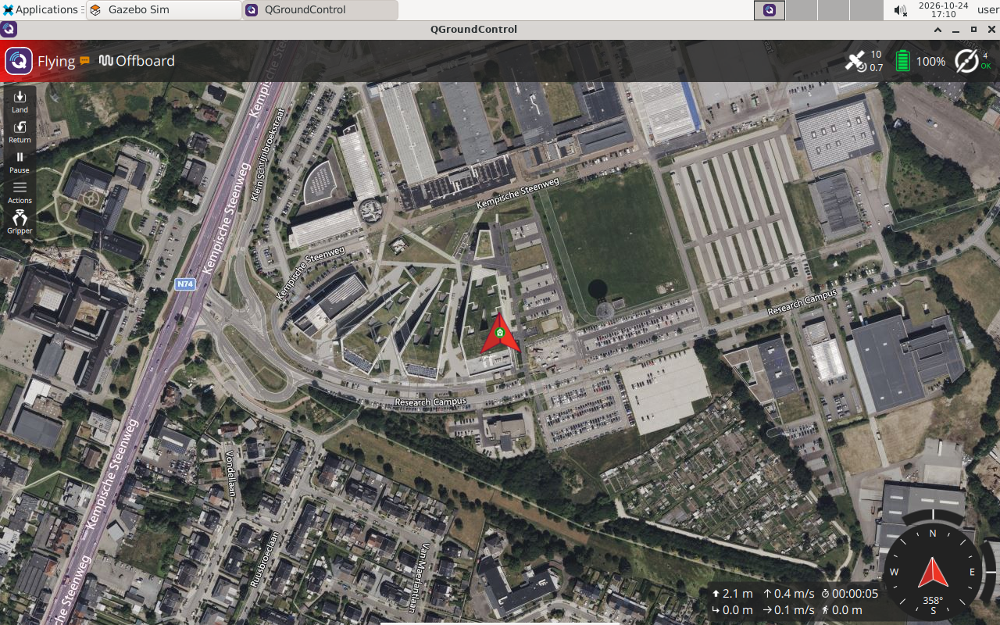

# 6 Your first ROS controlled flight

Your goal is to understand the complete flight lifecycle. Keep QGC connected, the simple world selected and the simulated vehicle disarmed. Only one node should publish flight targets.

## Run the known working example

**Container**:

```bash
ros2 run px4_dev_examples offboard_demo --sitl --altitude 3 --hold 5
```

Expected observations: Offboard mode, armed, climb three metres above the initial local position, hold, Land, touchdown, disarm and restored Hold. The terminal ends with `PASS: observed arm, takeoff, hold, landing and disarm`. Check Gazebo and QGC too.



The screenshot shows the Flying/Offboard state during a ROS-controlled simulation flight.

Read the complete [offboard.py](../../Projects/ros2_workspace/src/px4_dev_examples/px4_dev_examples/offboard.py). Its `run()` method sequences the stages; `wait_for()` spins ROS, streams control and enforces timeouts.

## Understand the three message roles

The following is an explanatory fragment from the streaming stage:

```python
mode = OffboardControlMode()
mode.timestamp = timestamp()
mode.position = True
self.control.publish(mode)

setpoint = TrajectorySetpoint()
setpoint.timestamp = timestamp()
setpoint.position = list(self.target)  # N, E, D in metres
setpoint.velocity = [math.nan] * 3
setpoint.acceleration = [math.nan] * 3
setpoint.yaw = 0.0
self.trajectory.publish(setpoint)
```

`OffboardControlMode` declares the requested control level and provides the live control stream. `TrajectorySetpoint` supplies the target. Unused velocity and acceleration values are NaN so they do not introduce unintended feedforward. `VehicleCommand` requests changes such as mode, arm and land. Their acknowledgements indicate command processing; observed vehicle state confirms what actually happened.

PX4 requires an established offboard heartbeat before mode entry and a continuing stream above 2 Hz. This implementation prestreams for three wall seconds, then continues publishing during its spin loop. It also republishes the target each cycle, although ROS offboard heartbeat and setpoint are distinct. See the [PX4 v1.17 offboard guide](https://docs.px4.io/v1.17/en/flight_modes/offboard) for the mode contract and configured loss behaviour.

## Exercise

Draw the lifecycle: wait for valid state → capture origin → prestream → request Offboard → observe mode → request arm → observe armed → climb → hold → request Land → observe landed/disarmed → restore Hold. Mark a timeout and a required observation on every transition.

Rerun with `--altitude 2 --hold 8` and compare observations. Explain why calling `time.sleep(8)` in place of the streaming hold loop would break control. Do not remove the prestream or readiness checks to shorten the example.

**Checkpoint:** a full flight completes, and you can explain why “command published” differs from “target reached”.

[Next: fly a square →](07-waypoints.md)
