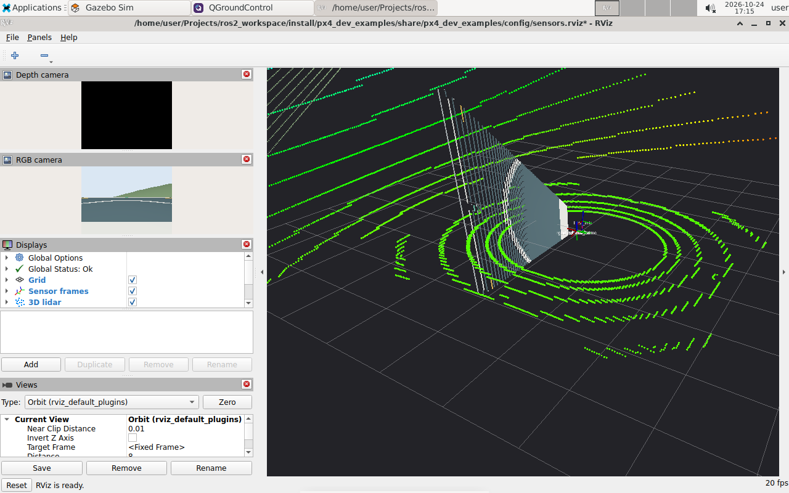
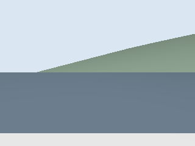
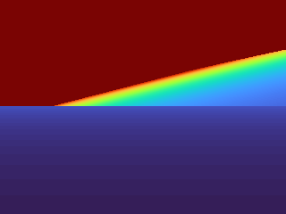

# 9 Inspect the camera and 3D lidar

Your goal is to interpret the drone's rendered sensor data. This lesson observes surroundings; it does not enable avoidance or autonomous landing.

For a more interesting view, stop the simple-world session while disarmed and start campus:

```bash
stop_px4_dev
PX4_GZ_WORLD=corda_campus start_px4_dev --no-attach
view_px4_sensors
```



RViz uses `base_link` as its fixed frame. These clouds are vehicle-relative; the provided TF does not give a world/map trajectory. The bridge supplies `/clock`, and RViz uses simulation time. The control examples retain wall time.

| Topic | Message and interpretation |
| --- | --- |
| `/drone/rgbd/image` | `Image`, RGB8 colour |
| `/drone/rgbd/depth_image` | `Image`, 32FC1 depth in metres |
| `/drone/rgbd/camera_info` | Camera calibration and projection information |
| `/drone/rgbd/points` | RGB-D `PointCloud2` |
| `/drone/lidar/points` | 720×16 3D `PointCloud2` |

Both sensors are configured at 10 Hz simulation time. Wall-time delivery can be slower with software rendering. The camera is 320×240 with a 0.15–20 m range; lidar range is 0.1–50 m.

## Check and process data

```bash
ros2 run px4_dev_examples sensor_check --save ~/Data/tutorial/sensors
python3 ~/ExampleCode/tutorial/inspect_lidar.py
ros2 run tf2_ros tf2_echo base_link rgbd_optical_frame
```

The lidar reader and `tf2_echo` run continuously. Press Ctrl+C before starting the next command, or use separate container shells.

The complete [lidar reader](../../ExampleCode/tutorial/inspect_lidar.py) examines XYZ fields with `sensor_msgs_py.point_cloud2.read_points`, discards non-finite values and reports minimum Euclidean range. It uses best-effort QoS and runs computation in a one-second reporting timer.

```python
if all(math.isfinite(value) for value in xyz):
    distance = math.sqrt(sum(value * value for value in xyz))
    nearest = min(nearest, distance)
```

The closest return can be the roof or ground, not a hazardous obstacle ahead. Camera optical coordinates use +Z forward, +X right and +Y down; read TF instead of assuming they match the lidar axes.





Depth colours are a preview; the ROS depth image itself contains floating-point metres.

## Exercise and checkpoint

Modify the reader to examine only points with positive lidar-frame X, then add a narrow forward cone. Compare with the all-direction minimum and explain what the filters exclude. Report “no valid returns” explicitly when the result stays infinite. Do not connect this distance directly to flight commands yet.

**Checkpoint:** show RGB, depth and both clouds; identify their frames and units. Explain why missing/invalid depth must not be interpreted as zero-distance geometry.

[Next: recording and evaluation →](10-recording.md)
