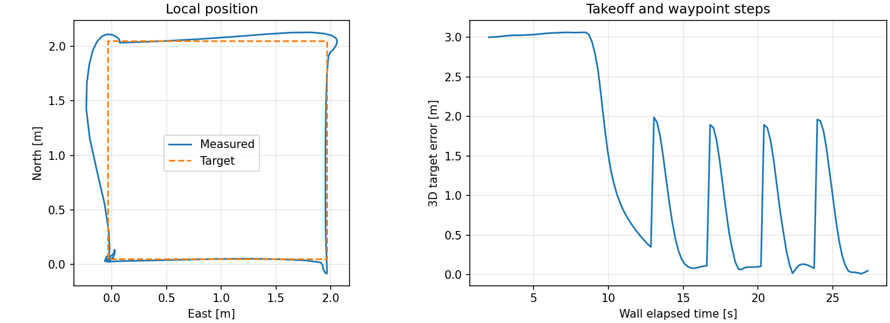

# 10 Record and evaluate a flight

Your goal is to preserve evidence and distinguish tracking performance from positioning accuracy. Use the simple world for another square flight.

## Record telemetry

**Container**, in one shell:

```bash
record_px4_rosbag
```

The helper records local position, vehicle status and command acknowledgements, resolving message-version suffixes. In another shell, run `fly_square.py --sitl --side 2`. After it lands, stop recording with Ctrl+C. Find the output path printed by the recorder:

```bash
ls -lt ~/Data/bags
ros2 bag info ~/Data/bags/px4-YYYYMMDD-HHMMSS
```

Replace that last example path with your actual directory. For a perception experiment, explicitly append topics to `record_px4_rosbag`, such as `/drone/lidar/points /tf_static /clock`. Images and clouds increase storage and processing load; they are not required for position evaluation.

## Evaluate the reference controller CSV

```bash
python3 ~/ExampleCode/tutorial/analyze_flight.py ~/Data/tutorial/square.csv
```

The [offline analyzer](../../ExampleCode/tutorial/analyze_flight.py) prints sample count, mean distance, RMSE and maximum distance for each stage. It requires only Python's standard library. Each CSV row stores actual and commanded NED coordinates:

```python
error = math.dist((north, east, down), target)
rmse = math.sqrt(sum(error * error for error in errors) / len(errors))
```

This is error relative to the requested setpoint. It includes takeoff and waypoint-step transients. It is not error against surveyed truth. Settling requires two seconds within tolerance in the controller; averaging all samples answers a different question. CSV times measure wall elapsed time, not simulation time.

Generate a trajectory and error plot inside the container (matplotlib is included):

```bash
python3 ~/ExampleCode/tutorial/plot_flight.py ~/Data/tutorial/square.csv
```



This example is from an actual completed 2 m tutorial square. East is horizontal and North vertical. The initial large vertical error belongs to takeoff; later peaks occur when the target steps to the next corner. Your trace will differ.

## Replay without commanding the live drone

Stop the live development session before replay:

```bash
stop_px4_dev
ros2 bag play ~/Data/bags/px4-YYYYMMDD-HHMMSS
```

Run only read-only analysis/subscriber nodes during replay. Do not launch an offboard controller against recorded state. The default recording helper excludes command inputs, but replaying a custom bag containing `/fmu/in/…` into a live simulator can send commands. Keep flight and replay separate.

## Exercise and checkpoint

Compare two square sizes with separate `--csv ~/Data/tutorial/square-1m.csv` and `square-2m.csv` output files. Report the number of completed waypoints, per-stage RMSE and maximum error, whether landing/disarm completed, and your rendering mode. Explain why different simulation speed or target-step size can affect the result.

**Checkpoint:** another student can inspect your bag metadata, run the CSV analyzer and distinguish a completed flight from a partial log.

[Next: campus project →](11-project.md)
