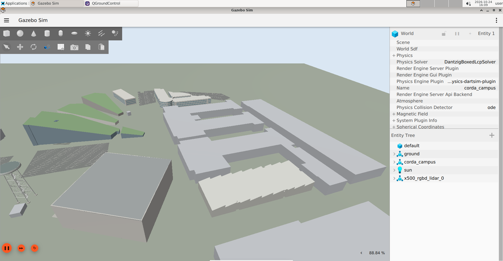

# 11 Corda Campus final project

Combine telemetry, state-based flight, sensor interpretation and evaluation. Your deliverable is a reproducible simulated rooftop flight with evidence, not a mission around unsurveyed buildings.



## Establish the launch surface

**Container**, after stopping any previous session:

```bash
PX4_GZ_WORLD=corda_campus start_px4_dev --no-attach
ros2 run px4_dev_examples campus_check
ros2 run px4_dev_examples sensor_check
```

The drone starts on a synthetic level deck on Corda 1. Building outlines are map-derived and heights/roof details include approximations. The deck is a simulation aid. Local PX4 origin and world coordinates are not interchangeable.

## Required project

1. Verify fresh position and status; reject an already armed vehicle.
2. Capture launch NED coordinates.
3. Take off three metres relative to launch, observe arrival and hold for five seconds.
4. Return to the launch horizontal coordinates, request Land and observe touchdown/disarm.
5. Record telemetry, save a sensor preview and run `campus_check` again after landing.
6. Submit code, exact commands, logs and screenshots showing flight and landed state.

Begin with the existing hover demo. For a small optional pattern, use the square controller with **side 1 m** only after checking clearance in Gazebo. The six-metre platform does not make arbitrary routes safe: the drone has finite size, can overshoot and the surroundings have higher structures. A campus-wide mission needs a separate surveyed/validated route and obstacle strategy.

## Explain your design

Your report must answer: Which frame are your targets in? How do you know a waypoint was reached? What happens if telemetry stops? Which clock drives the control loop? What can the lidar see from the roof? Why is QGC imagery not collision geometry? How do you distinguish a command acknowledgement from a completed landing?

## Optional extensions

Create a read-only obstacle-sector visualisation; implement interpolated position targets in the empty world; plot recorded trajectories; or create a ROS package for your controller. Keep SLAM, avoidance and precision landing as separate projects with their own assumptions and validation.

**Completion:** a classmate can run your documented workflow in the prepared container, reproduce an observed takeoff and landing, and explain the limits of the sensor and control implementation.

[Instructor notes and answer guide →](instructor.md)
