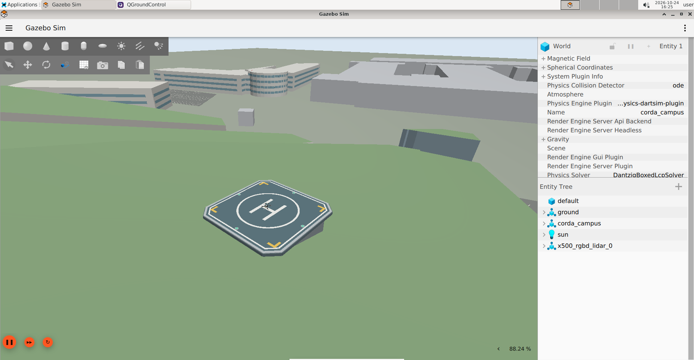

# PX4 drone control with Python and ROS 2

Build a ROS 2 program that reads a simulated drone's state, takes off, follows a small square and lands. Then inspect its RGB-D camera and 3D lidar, record a flight and apply your work to Corda Campus. PX4 handles estimation and the inner flight-control loops; your Python program supplies position targets.

This course assumes basic Python, ROS nodes/topics/subscribers, a terminal and a little Git. You do not need previous PX4 experience. Use the pinned Ubuntu 24.04 / ROS 2 Jazzy / Gazebo Harmonic / PX4 v1.17 environment in this repository. Allow about **12–16 contact hours plus installation time**, adjusted to your class. All flight exercises use local SITL, with no physical vehicle connected.

## Lessons

| Lesson | You will learn | Approximate class time |
| --- | --- | --- |
| [1 Understand the system](01-system.md) | Components, data paths and control responsibility | 45 min |
| [2 Build and start](02-environment.md) | Docker, persistence, tmux and readiness | 60 min after downloads |
| [3 Fly with QGroundControl](03-qgroundcontrol.md) | Arming, modes and observed flight state | 45 min |
| [4 Read telemetry in Python](04-telemetry.md) | Messages, QoS, callbacks and validity | 90 min |
| [5 Coordinates and time](05-coordinates.md) | NED, ENU, reference altitude and clocks | 60 min |
| [6 First ROS flight](06-offboard.md) | Setpoints, command acknowledgements and lifecycle | 90 min |
| [7 Fly a square](07-waypoints.md) | Relative waypoints, arrival and state transitions | 90 min |
| [8 Diagnose failures](08-failures.md) | Recovery, timeouts and interruption | 60 min |
| [9 Camera and lidar](09-perception.md) | Images, clouds, TF and finite returns | 90 min |
| [10 Record and evaluate](10-recording.md) | rosbag, CSV and tracking error | 60 min |
| [11 Campus project](11-project.md) | Combine control, observations and evidence | 120 min |

Every lesson has runnable commands, an explanation, an exercise and a checkpoint. Read [the instructor notes and answer guide](instructor.md) for preparation, assessment and solutions. The complete Python reference programs live in [ExampleCode/tutorial](../../ExampleCode/tutorial); they are teaching examples, not a general autonomous-navigation stack.

## Conventions

Commands marked **Host** run in a host terminal from the repository root. Commands marked **Container** run in the Docker shell, normally attached using `./003_attach_bash_to_px4_ros2_container.sh`. Commands marked **PX4 console** are sent through `px4_command` from a container shell. Python snippets labelled **fragment** explain part of a program; complete programs are linked separately.

Use a second container shell for ROS commands while the session runs. Keep QGC connected during flight. Run one flight controller at a time. Stop the simulation before changing worlds. Begin lessons 3–8 in `default`, an open world, rather than beside campus buildings. Stop live control before replaying recorded command topics.

Screenshots show this repository's software-rendered desktop. Window sizes, map tiles and sensor views may differ on your machine. [Screenshot notes](images/README.md) identify each view.

[Start lesson 1 →](01-system.md)
